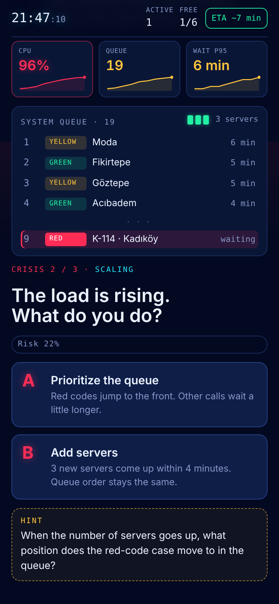
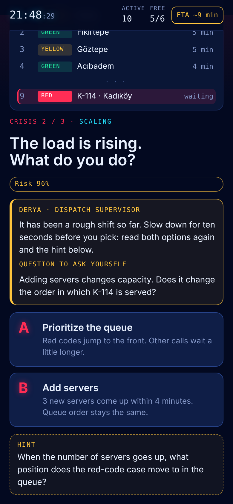
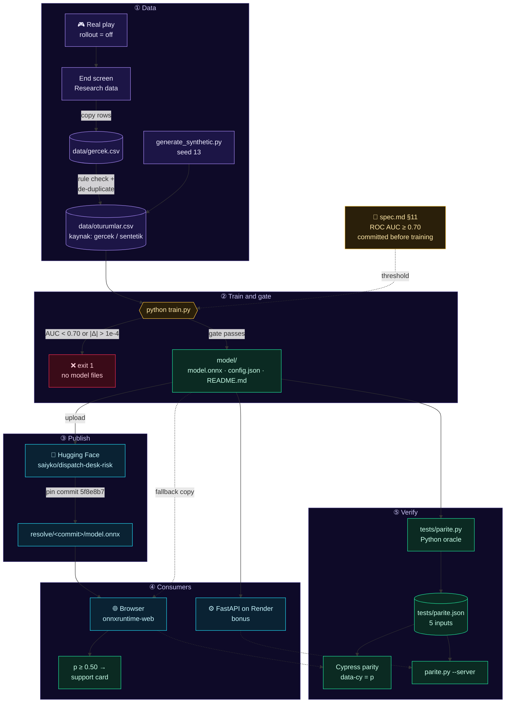
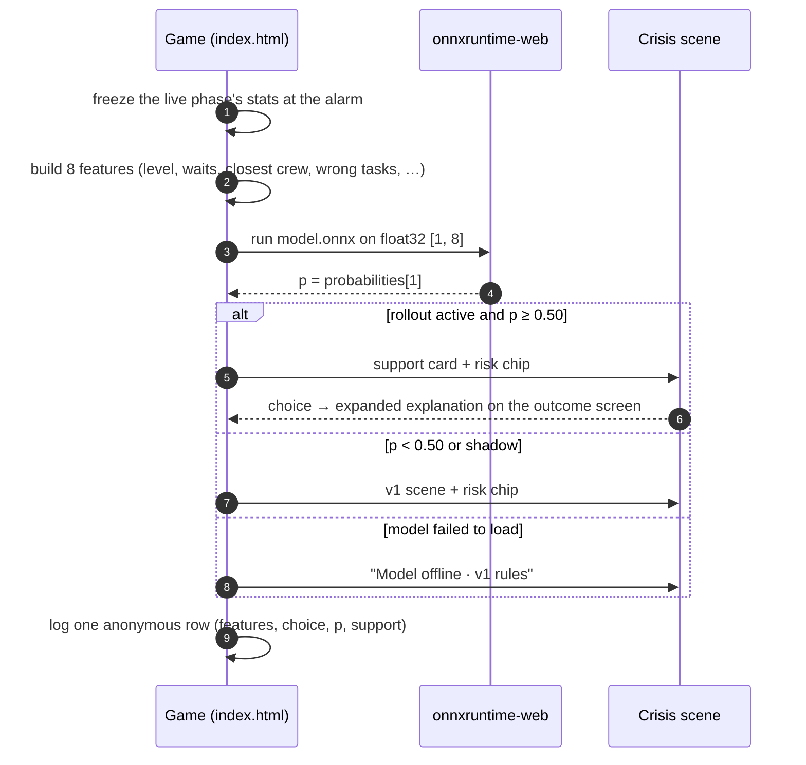

<p align="center">
  
</p>

<p align="center">
  <a href="https://sayko89.github.io/dispatch-desk-v2/"></a>
  <a href="https://huggingface.co/saiyko/dispatch-desk-risk"></a>
  <a href="https://dispatch-desk-v2-api.onrender.com/health"></a>
  <a href="https://youtube.com/shorts/un7lmACvZM4"></a>
</p>

# Dispatch Desk v2 · the game reads how you play

> **v1** taught three engineering decisions with a story and a Socratic tutor ([`V1.md`](V1.md)).
> **v2** adds a small model that runs **in the player's browser**. When a crisis opens, it estimates how likely this player is to pick the costly option, and it steps in only when that risk is high.

YZM301 · *The Primer v2* · Samsun University, Software Engineering

<table>
  <tr>
    <th width="50%">Steady player · Crisis 2 · <code>p = 0.22</code></th>
    <th width="50%">Struggling player · same scene · <code>p = 0.96</code></th>
  </tr>
  <tr>
    <td></td>
    <td></td>
  </tr>
  <tr>
    <td>Below τ = 0.50: the scene is exactly v1.</td>
    <td>Above τ: Derya's support card, then the expanded explanation on the outcome screen. It never says which option is better.</td>
  </tr>
</table>

## At a glance

| | |
|---|---|
| 🎯 **Predicts** | `P(costly choice)` at the start of each crisis, from 8 behaviour features |
| 🧮 **Model** | `StandardScaler → LogisticRegression`, seed 13 → ONNX, **593 bytes** |
| ✅ **Gate** | ROC AUC **0.761** ≥ 0.70 (threshold committed before training) |
| 👥 **Data** | **16 real sessions** (48 rows) + 600 seeded synthetic rows, no personal data |
| 🔁 **Parity** | browser vs Python **3e-8**, FastAPI vs Python **0** in a local run (limit 1e-4) |
| 🚦 **Release** | off → shadow → canary 5 % → 25/50/100 %, one-line rollback |

## Links

| | |
|---|---|
| **Play** | https://sayko89.github.io/dispatch-desk-v2/ (model on by default; `?rollout=off` gives v1) |
| **Model** | https://huggingface.co/saiyko/dispatch-desk-risk · pinned: `…/resolve/5f8e8b7afd56208ad4263572c0294427ca65b05d/model.onnx` |
| **Server (bonus)** | https://dispatch-desk-v2-api.onrender.com · [`/health`](https://dispatch-desk-v2-api.onrender.com/health) · `POST /predict` · source [`server/`](server/) |
| **Demo** | https://youtube.com/shorts/un7lmACvZM4 (two players, same scene, different model decisions) |
| **v1** | [`V1.md`](V1.md) · [Stitch design](https://stitch.withgoogle.com/projects/9828801172742432808) · [AI Studio](https://ai.studio/apps/c92c0966-9d92-45c2-bc3c-554fd44dcc52) |

## Setup (3 commands)

```bash
pip install -r requirements.txt   # Python 3.11+: scikit-learn, skl2onnx, onnxruntime
python train.py                   # trains with seed 13, checks the gate, writes model/
npm install                       # Cypress
```

Then `npm run test:all` runs everything (below). To play locally, serve the folder with `python -m http.server` and open `http://localhost:8000/`. The model is loaded with `fetch`, so opening the file directly shows "Model offline · v1 rules".

## How v2 fits together



### What happens when a crisis opens



### Where each deliverable lives

| Deliverable | File |
|---|---|
| Model requirement, metric, threshold, AE-6…8 | [`spec.md`](spec.md) §11 (threshold commit `52a2e8f`, before any training) |
| Data and dictionary | [`data/oturumlar.csv`](data/oturumlar.csv), [`data/SOZLUK.md`](data/SOZLUK.md) |
| Training with a gate | [`train.py`](train.py) |
| Model, config, model card | [`model/`](model/) |
| Release, rollback, trade-offs | [`RELEASE.md`](RELEASE.md) |
| Python oracle and reference values | [`tests/parite.py`](tests/parite.py), [`tests/parite.json`](tests/parite.json) |
| E2E: parity, regression, AE-6…8, demo | [`cypress/`](cypress/) |
| Exam question | [`SINAV_TASARIMI.md`](SINAV_TASARIMI.md) |

## The model

- **Target** `maliyetli_secim`: 1 if the player picks the option that costs minutes or privacy (Crisis 1 A, Crisis 2 B, Crisis 3 B; a timeout counts as the default, which is the costly option).
- **Features** (8, known when the scene opens; see [`data/SOZLUK.md`](data/SOZLUK.md)): level, crisis number, average call wait in the previous live phase, share sent to the closest crew, calls still waiting, wrong field tasks so far, earlier costly choices, seconds spent on the previous decision.
- **Model:** `StandardScaler → LogisticRegression`, seed 13, exported to ONNX (opset 17, zipmap off). The file is under 1 KB.
- **Gate:** ROC AUC ≥ 0.70 on a stratified 30 % hold-out. Below it, `train.py` exits with code 1 and deletes `model/`. ONNX must match scikit-learn within 1e-4.
- **Results:** in [`model/config.json`](model/config.json) → `metrics`, including ROC AUC on real rows only.

## Data

`data/oturumlar.csv` has a `kaynak` column: `gercek` for real play and `sentetik` for generated rows.

- **Real rows:** friends played the published game with the model off. On the end screen they pressed *Copy all sessions on this device* and sent me the rows. The rows hold no personal data: the session ID is 8 random hex characters made in the browser, and there is no name, location or device field.
- **Synthetic rule and seed:** `python data/generate_synthetic.py` simulates 200 sessions with **seed 13**. Each simulated player has a hidden skill `s ~ N(0, 1)` that shapes their level, live play and thinking time. The label comes from a logistic rule with noise:

  `logit = −0.40 + scene offset + 0.35·(wait−3.0) − 0.90·(closest−0.6) + 0.25·waiting + 0.30·wrong + 0.45·earlier_costly − 0.08·(prev_sec−6) − 0.35·level + N(0, 0.3)`

  The scene offsets are C1 +0.30, C2 0 and C3 −0.10. An Experienced player who would take more than 60 s times out. The script writes the real rows first, then the synthetic ones, and gives the same file every time.

  This is rule `synthetic-2`. The first rule was noisier and did not match real play, and the first training with real rows **failed the gate** (ROC AUC 0.667 < 0.70). The reason and the fix are in [`data/SOZLUK.md`](data/SOZLUK.md) and the spec's decision log. The threshold was not changed.

## In the game

| | Model off (v1) | Model on, p < 0.50 | Model on, p ≥ 0.50 |
|---|---|---|---|
| Crisis scene | hint rules by level, timer for Experienced | same + a small "Risk 22%" chip | same + **support card** (`destek-kart`) |
| Outcome screen | expanded note only for the chosen goal | same | expanded note (`sonuc-derin`) for this crisis too |
| Arrival minutes, endings | rules from spec §2 | unchanged | unchanged |

The rollout stage is the `ROLLOUT` constant in `index.html` (`off` / `shadow` / `canary` 5 % / `on`); `?rollout=` overrides it. If the model cannot be loaded, the game says *Model offline · v1 rules* and plays as v1 (AE-8). The **Model lab** (intro footer) shows the model's output for any input in `data-cy="p"`; the parity test uses it.

## Tests

```bash
npm run test:e2e          # v1: 8 paths + AE-1…5 (model off)
npm run test:regression   # the same v1 tests with --env rollout=on
npm run test:model        # parity (5 inputs, |Δ| < 1e-4) + AE-6, AE-7, AE-8
npm run demo:v2           # demo video: two players, same scene, different decisions
python tests/parite.py --check                    # oracle: onnxruntime vs scikit-learn vs parite.json
python tests/parite.py --server https://dispatch-desk-v2-api.onrender.com   # bonus: FastAPI gives the same p
```

The browser parity and the regression suite were also replayed with Playwright, using the same selectors and a local onnxruntime-web 1.22.0. The worst browser difference was below 2e-7, and P1–P8 and AE-1…5 passed with the model on. The CI workflow [`.github/workflows/model.yml`](.github/workflows/model.yml) reruns `train.py` and the oracle on every data or model change.

## Known limitations

- **The model does not yet predict real players.** On the 16 real rows in the test split, ROC AUC is about 0.22 (`roc_auc_real_only` in `model/config.json`). The gate is met on the whole test split, which is mostly synthetic. Real players decided in 2–7 s and often picked differently from the synthetic rule, so the rule's assumptions (slow, careful players avoid the costly option) are not confirmed by real play. With 16 sessions this is a warning sign, not a measurement. The next step is more real sessions with model_p logged (the rollout now records it) and replacing the synthetic rule with what real play shows.
- Real players were the author and friends, mostly at the Experienced level.
- The support card can only help; it never changes minutes or endings, so a wrong prediction costs the player at most a few seconds of reading.

## Repository layout

```
.
├── index.html              # the game, v2 (single file; GitHub Pages serves it)
├── spec.md                 # v1 spec + §11 model requirement, metric, threshold, AE-6…8
├── train.py                # training + gate + ONNX export + model card
├── data/                   # oturumlar.csv, gercek.csv, generate_synthetic.py, SOZLUK.md
├── model/                  # model.onnx, config.json, README.md (model card, also on Hugging Face)
├── tests/                  # parite.py (Python oracle), parite.json (5 reference inputs)
├── server/                 # FastAPI consumer (bonus) + render.yaml at the root
├── cypress/                # v1 specs + parite, model (AE-6…8), demo-v2
├── RELEASE.md              # v2.0 changes, pinned commit, rollout, rollback, trade-off matrix
├── SINAV_TASARIMI.md       # exam question design
├── V1.md                   # v1 README (game, design, tutor eval)
└── aistudio/ design/ eval/ stitch/ screenshots/   # v1 material
```

## Sources

- Amershi, S. et al. (2019). *Software Engineering for Machine Learning: A Case Study.* ICSE-SEIP. Used for the ML workflow stages (data → training → evaluation → deployment → monitoring).
- Shankar, S. et al. (2022). *Operationalizing Machine Learning: An Interview Study.* Used for staged rollouts, shadow deployment and keeping a rollback path.
- Mitchell, M. et al. (2019). *Model Cards for Model Reporting.* FAT\*. Used as the structure of `model/README.md`.
- Breck, E. et al. (2017). *The ML Test Score.* IEEE Big Data. Used for the gate, the training/serving parity test and reproducible training.
- Sculley, D. et al. (2015). *Hidden Technical Debt in Machine Learning Systems.* NeurIPS. Used to keep features simple and documented.
- Course starter: `seyyah/huggingface-hello-web` (train → ONNX → browser pattern, 1e-4 export check).
- onnxruntime-web, scikit-learn and skl2onnx documentation.

## AI use

- **Claude (Anthropic, via Claude Code)** wrote the code and the first drafts of the documents from my requirements: the telemetry and model integration in `index.html`, `train.py`, the synthetic generator, `tests/parite.py`, the FastAPI server, the Cypress specs, `README.md`, `RELEASE.md` and `SINAV_TASARIMI.md`. It also replayed the tests with Playwright. Every commit made with it carries a `Co-Authored-By` line.
- **My decisions:** what the model predicts (costly-decision risk, chosen over other targets), collecting real data instead of using synthetic data only, the browser as the main runtime with a FastAPI server as the bonus, GitHub Pages as the host, and the README's new look and flow diagram.
- **Done by me outside the AI tool:** I played sessions with friends and collected the **16 real sessions**. I enabled GitHub Pages, created the Hugging Face repo, uploaded the model and pinned its commit, deployed the API on Render, and recorded and published the demo video.
- **Fixed after review:** After the real rows were added, the first model **failed the gate** (ROC AUC 0.667). We kept the 0.70 threshold and fixed the synthetic rule instead (see the spec's decision log). A batch of rows that did not match the game's rules was rejected, and a rule check was added to the data pipeline. The support card repeated the hint, so it was reworded.
- **v1 tools still in the game:** Google Stitch (screen design) and Gemini in AI Studio (the tutor). See [`V1.md`](V1.md).
