<p align="center">
  
</p>

<p align="center">
  <a href="https://sayko89.github.io/dispatch-desk-v2/"></a>
  <a href="https://huggingface.co/saiyko/dispatch-desk-risk"></a>
  <a href="tests/"></a>
  <a href="RELEASE.md"></a>
</p>

# SE Primer: Dispatch Desk v2 · an on-device model

**v2 adds a small machine-learning model to the [Dispatch Desk](V1.md) story game. The model runs in the player's browser and changes how the game treats each player.**
YZM301 · *The Primer v2* assignment · Samsun University, Software Engineering

When a crisis opens, the model estimates **p = P(this player will pick the costly option)** from how they have played so far: how long calls waited, whether they sent the closest crew, how many field tasks they got wrong, earlier choices and thinking time. If p ≥ 0.50, the game slows the player down with a support card from Derya and, after the decision, the expanded explanation. It never says which option is better. The numbers, the endings and every v1 test stay the same.

## Links

| | |
|---|---|
| **Play it (GitHub Pages)** | https://sayko89.github.io/dispatch-desk-v2/ · model on: [`?rollout=on`](https://sayko89.github.io/dispatch-desk-v2/?rollout=on) |
| **Model (Hugging Face)** | https://huggingface.co/saiyko/dispatch-desk-risk · pinned: `https://huggingface.co/saiyko/dispatch-desk-risk/resolve/5f8e8b7afd56208ad4263572c0294427ca65b05d/model.onnx` |
| **Server consumer (bonus)** | https://dispatch-desk-v2-api.onrender.com ([`/health`](https://dispatch-desk-v2-api.onrender.com/health), `POST /predict`) · source in [`server/`](server/) |
| **Demo video** | `DEMO_URL` (two players, same scene, different model decisions) |
| v1 game, design and tutor eval | [`V1.md`](V1.md) · [Stitch](https://stitch.withgoogle.com/projects/9828801172742432808) · [AI Studio](https://ai.studio/apps/c92c0966-9d92-45c2-bc3c-554fd44dcc52) |

## Setup (3 commands)

```bash
pip install -r requirements.txt   # Python 3.11+: scikit-learn, skl2onnx, onnxruntime
python train.py                   # trains with seed 13, checks the gate, writes model/
npm install                       # Cypress
```

Then `npm run test:all` runs the v1 tests, the same tests with the model on, the parity test and AE-6…8. To play locally, serve the folder (`python -m http.server`) and open `http://localhost:8000/?rollout=on`. The model is loaded with `fetch`, so opening the file directly gives "Model offline · v1 rules".

## How v2 fits together

```
real play (rollout off) ──► end screen "Research data" ──► data/gercek.csv ─┐
data/generate_synthetic.py (seed 13) ───────────────────────────────────────┴► data/oturumlar.csv
                                                                                   │
                     spec.md §11: ROC AUC ≥ 0.70, committed before training        ▼
                                                                              python train.py
                                                         gate fails → exit 1, no files │ gate passes
                                                                                       ▼
                                          model/model.onnx + config.json + README.md (model card)
                                                       │ upload, pin commit                │
                                                       ▼                                   ▼
                     https://huggingface.co/saiyko/dispatch-desk-risk/resolve/<commit>/   tests/parite.py (oracle)
                                 │                       │                                 │ parite.json
                                 ▼                       ▼                                 ▼
                   browser: onnxruntime-web    server/ FastAPI (bonus)          Cypress parity |Δ| < 1e-4
```

| Deliverable | File |
|---|---|
| Model requirement, metric, threshold, AE-6…8 | [`spec.md`](spec.md) §11 (threshold commit `52a2e8f`, before any training) |
| Data and dictionary | [`data/oturumlar.csv`](data/oturumlar.csv), [`data/SOZLUK.md`](data/SOZLUK.md) |
| Training with a gate | [`train.py`](train.py) |
| Model, config, model card | [`model/`](model/) |
| Release, rollback, trade-offs | [`RELEASE.md`](RELEASE.md) |
| Python oracle and reference values | [`tests/parite.py`](tests/parite.py), [`tests/parite.json`](tests/parite.json) |
| E2E: parity, regression, AE-6…8, demo | [`cypress/`](cypress/) |
| Exam question | [`SINAV_TASARIMI.md`](SINAV_TASARIMI.md) |

## The model

- **Target** `maliyetli_secim`: 1 if the player picks the option that costs minutes or privacy (Crisis 1 A, Crisis 2 B, Crisis 3 B; a timeout counts as the default, which is the costly option).
- **Features** (8, known when the scene opens; see [`data/SOZLUK.md`](data/SOZLUK.md)): level, crisis number, average call wait in the previous live phase, share sent to the closest crew, calls still waiting, wrong field tasks so far, earlier costly choices, seconds spent on the previous decision.
- **Model:** `StandardScaler → LogisticRegression`, seed 13, exported to ONNX (opset 17, zipmap off). The file is under 1 KB.
- **Gate:** ROC AUC ≥ 0.70 on a stratified 30 % hold-out. Below it, `train.py` exits with code 1 and deletes `model/`. ONNX must match scikit-learn within 1e-4.
- **Results:** in [`model/config.json`](model/config.json) → `metrics`, including ROC AUC on real rows only.

## Data

`data/oturumlar.csv` has a `kaynak` column: `gercek` for real play and `sentetik` for generated rows.

- **Real rows:** friends played the published game with the model off. On the end screen they pressed *Copy all sessions on this device* and sent me the rows. The rows hold no personal data: the session ID is 8 random hex characters made in the browser, and there is no name, location or device field.
- **Synthetic rule and seed:** `python data/generate_synthetic.py` simulates 200 sessions with **seed 13**. Each simulated player has a hidden skill `s ~ N(0, 1)` that shapes their level, live play and thinking time. The label comes from a logistic rule with noise:

  `logit = −0.40 + scene offset + 0.35·(wait−3.0) − 0.90·(closest−0.6) + 0.25·waiting + 0.30·wrong + 0.45·earlier_costly − 0.08·(prev_sec−6) − 0.35·level + N(0, 0.3)`

  The scene offsets are C1 +0.30, C2 0 and C3 −0.10. An Experienced player who would take more than 60 s times out. The script writes the real rows first, then the synthetic ones, and gives the same file every time.

  This is rule `synthetic-2`. The first rule was noisier and did not match real play, and the first training with real rows **failed the gate** (ROC AUC 0.667 < 0.70). The reason and the fix are in [`data/SOZLUK.md`](data/SOZLUK.md) and the spec's decision log. The threshold was not changed.

## In the game

| | Model off (v1) | Model on, p < 0.50 | Model on, p ≥ 0.50 |
|---|---|---|---|
| Crisis scene | hint rules by level, timer for Experienced | same + a small "Risk 22%" chip | same + **support card** (`destek-kart`) |
| Outcome screen | expanded note only for the chosen goal | same | expanded note (`sonuc-derin`) for this crisis too |
| Arrival minutes, endings | rules from spec §2 | unchanged | unchanged |

The rollout stage is the `ROLLOUT` constant in `index.html` (`off` / `shadow` / `canary` 5 % / `on`); `?rollout=` overrides it. If the model cannot be loaded, the game says *Model offline · v1 rules* and plays as v1 (AE-8). The **Model lab** (intro footer) shows the model's output for any input in `data-cy="p"`; the parity test uses it.

## Tests

```bash
npm run test:e2e          # v1: 8 paths + AE-1…5 (model off)
npm run test:regression   # the same v1 tests with --env rollout=on
npm run test:model        # parity (5 inputs, |Δ| < 1e-4) + AE-6, AE-7, AE-8
npm run demo:v2           # demo video: two players, same scene, different decisions
python tests/parite.py --check                    # oracle: onnxruntime vs scikit-learn vs parite.json
python tests/parite.py --server https://dispatch-desk-v2-api.onrender.com   # bonus: FastAPI gives the same p
```

The browser parity and the regression suite were also replayed with Playwright, using the same selectors and a local onnxruntime-web 1.22.0. The worst browser difference was below 2e-7, and P1–P8 and AE-1…5 passed with the model on. The CI workflow [`.github/workflows/model.yml`](.github/workflows/model.yml) reruns `train.py` and the oracle on every data or model change.

## Known limitations

- **The model does not yet predict real players.** On the 16 real rows in the test split, ROC AUC is about 0.22 (`roc_auc_real_only` in `model/config.json`). The gate is met on the whole test split, which is mostly synthetic. Real players decided in 2–7 s and often picked differently from the synthetic rule, so the rule's assumptions (slow, careful players avoid the costly option) are not confirmed by real play. With 16 sessions this is a warning sign, not a measurement. The next step is more real sessions with model_p logged (the rollout now records it) and replacing the synthetic rule with what real play shows.
- Real players were the author and friends, mostly at the Experienced level.
- The support card can only help; it never changes minutes or endings, so a wrong prediction costs the player at most a few seconds of reading.

## Repository layout

```
.
├── index.html              # the game, v2 (single file; GitHub Pages serves it)
├── spec.md                 # v1 spec + §11 model requirement, metric, threshold, AE-6…8
├── train.py                # training + gate + ONNX export + model card
├── data/                   # oturumlar.csv, gercek.csv, generate_synthetic.py, SOZLUK.md
├── model/                  # model.onnx, config.json, README.md (model card, also on Hugging Face)
├── tests/                  # parite.py (Python oracle), parite.json (5 reference inputs)
├── server/                 # FastAPI consumer (bonus) + render.yaml at the root
├── cypress/                # v1 specs + parite, model (AE-6…8), demo-v2
├── RELEASE.md              # v2.0 changes, pinned commit, rollout, rollback, trade-off matrix
├── SINAV_TASARIMI.md       # exam question design
├── V1.md                   # v1 README (game, design, tutor eval)
└── aistudio/ design/ eval/ stitch/ screenshots/   # v1 material
```

## Sources

- Amershi, S. et al. (2019). *Software Engineering for Machine Learning: A Case Study.* ICSE-SEIP. Used for the ML workflow stages (data → training → evaluation → deployment → monitoring).
- Shankar, S. et al. (2022). *Operationalizing Machine Learning: An Interview Study.* Used for staged rollouts, shadow deployment and keeping a rollback path.
- Mitchell, M. et al. (2019). *Model Cards for Model Reporting.* FAT\*. Used as the structure of `model/README.md`.
- Breck, E. et al. (2017). *The ML Test Score.* IEEE Big Data. Used for the gate, the training/serving parity test and reproducible training.
- Sculley, D. et al. (2015). *Hidden Technical Debt in Machine Learning Systems.* NeurIPS. Used to keep features simple and documented.
- Course starter: `seyyah/huggingface-hello-web` (train → ONNX → browser pattern, 1e-4 export check).
- onnxruntime-web, scikit-learn and skl2onnx documentation.

## AI use

- **Claude (Anthropic, Claude Code):** wrote the first drafts of the telemetry code in `index.html`, `train.py`, `tests/parite.py`, the synthetic generator, the FastAPI server, the Cypress specs and these documents. It also ran the Playwright replays.
- **Decided by hand:** the model target (costly-decision risk), the 0.70 threshold before training, the browser-first deployment and the real data collection. The real sessions were played by people and copied in by hand.
- **Fixed by hand after review:** *(write here what you changed yourself, e.g. a feature definition, wording in the support card, the synthetic rule's weights)*.
- **Done outside AI tools:** the Hugging Face upload and commit pin, the Render deploy, the demo video recording and the final check of every number in this README against `model/config.json`.
- **v1 tools still in the game:** Google Stitch (screen design) and Gemini in AI Studio (tutor). See [`V1.md`](V1.md).
